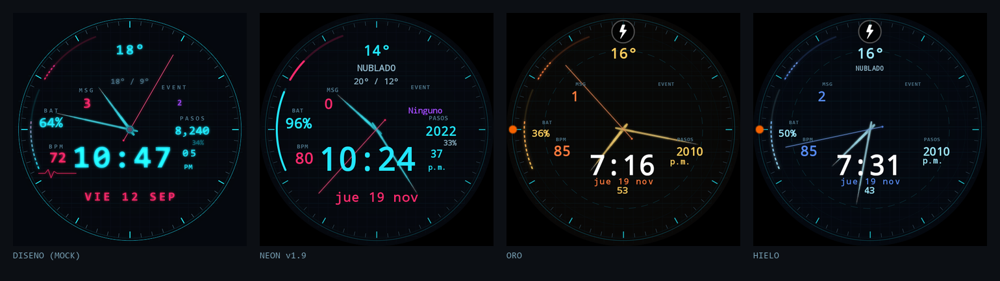

# Neon Grid — carátula cyberpunk para Galaxy Watch 6

Carátula hecha con el **Watch Face Format** oficial de Wear OS: no es una app, es un
paquete de recursos que el propio sistema del reloj dibuja. Consume muy poca batería y se
instala como cualquier esfera (sección **Descargados** del selector).

**Versión 2.1 — probada en un Galaxy Watch 6 real (SM‑R940, Wear OS 6 / SDK 36).** Tres paletas: neón, oro e hielo.



---

## 1. Qué muestra

| Zona | Dato | Fuente WFF |
|---|---|---|
| Centro | Hora analógica (horaria y minutera) + segundero | `AnalogClock` |
| Hora digital | En color de acento de la paleta (cian / ámbar / celeste), no en blanco | `[HOUR_1_12]`, `[MINUTE_Z]` |
| Bajo la hora | Hora grande anclada a la derecha, segundos y AM/PM a su derecha | `[HOUR_1_12]`, `[MINUTE_Z]`, `[SECOND_Z]`, `[AMPM_STRING]` |

| Arriba | Temperatura, condición y máx/mín del día | `[WEATHER.TEMPERATURE]`, `<Condition>` sobre `[WEATHER.CONDITION]`, `[WEATHER.DAY_TEMPERATURE_HIGH/LOW]` |
| Chip MSG | Notificaciones sin leer (incluye WhatsApp), acotado 0–99 | `clamp([UNREAD_NOTIFICATION_COUNT],0,99)` |
| Chip EVENT | Próximo evento en dos líneas (hora + nombre), Short y Long text | `[COMPLICATION.TITLE]`, `[COMPLICATION.TEXT]`, `[COMPLICATION.LONG_TEXT]` |
| Izquierda | Batería con `%` | `[BATTERY_PERCENT]` |
| Abajo izq. | Ritmo cardíaco | `[HEART_RATE]` |
| Abajo der. | Pasos + % de la meta diaria | `[STEP_COUNT]`, `[STEP_PERCENT]` |
| Bajo la fecha | Hora mundial (`BCN`) en 24 h, con horario de verano | `icuText("HH:mm", [UTC_TIMESTAMP] + desfase)` |
| Medidores | Arco izquierdo = batería; arco superior = meta de pasos | `Transform target="endAngle"` con `[BATTERY_PERCENT]` y `[STEP_PERCENT]` |
| Always On | Fondo negro, agujas grises, solo hora y fecha | `Variant mode="AMBIENT"` |

La hora se puede cambiar a **24 h** con una bandera (`--h24`), ver §5.

La **hora mundial** se calcula en el reloj: parte de su hora local y le suma la
diferencia con España, que el XML deriva de la fecha usando la regla europea
(último domingo de marzo a último domingo de octubre), así que cambia sola con el
horario de verano. (Se intentó que fuera una complicación elegible con ciudad;
ver docs/HANDOFF.md 4.13: el runtime no lo soporta bien en este reloj.) Como el
desfase depende de la zona del reloj, al compilar se indica con
`--device-utc-offset` (por defecto `-5`, Bogotá):

```powershell
python tools\gen_watchface.py --format 2 --palette neon --device-utc-offset -5
```

El **clima** se oculta con un guion cuando el reloj no tiene datos del teléfono
(`[WEATHER.IS_AVAILABLE]`); si ves `0°` es que el teléfono no ha sincronizado el
tiempo todavía, no un fallo de la esfera.

---

## 2. Instalar

```powershell
cd C:\Proyectos\relog
powershell -ExecutionPolicy Bypass -File .\install.ps1
```

Pide dos pares IP:puerto: el de **emparejamiento** (una vez, código de 6 dígitos que caduca
en ~2 min) y el de **conexión** (pantalla principal de *Depuración inalámbrica*).

**Dónde aparece:** no sale en favoritos ni en la app del teléfono. Mantén pulsada la esfera →
desliza el carrusel **hasta el final** → **“Añadir carátula de reloj”** → sección
**Descargados** → elige **Neon Grid** (o **Neon Grid Oro**).

Para el chip de eventos: mantén pulsada la esfera → **Editar** → toca **EVENT** → elige
**Calendario** (o *Mensajes/WhatsApp*: la ranura acepta cualquier `SHORT_TEXT`).

### APKs incluidos

| Archivo | Wear OS | Formato | Clima | Color |
|---|---|---|---|---|
| `build/NeonGrid-wearos5.apk` | 5+ (API 34+) | WFF v2 | Sí | neón (cian/magenta) |
| `build/NeonGrid-wearos4.apk` | 4 (API 33) | WFF v1 | No | neón |
| `build/NeonGrid-gold-wearos5.apk` | 5+ | WFF v2 | Sí | oro (ámbar/naranja) |
| `build/NeonGrid-ice-wearos5.apk` | 5+ | WFF v2 | Sí | hielo (celeste/azul) |

---

| Toque | Abre |
|---|---|
| Temperatura | App de Clima de Samsung |
| MSG | WhatsApp (lista de chats) |
| Batería | Ajustes de batería |
| BPM | Medidor de ritmo cardíaco de Samsung Health |
| Pasos | Pantalla de pasos de Samsung Health |
| Fecha | Calendario |
| Evento | App del calendario (vía complicación) |
## 3. Paletas

Hay tres paletas definidas en [`design/render.py`](design/render.py):

| Paleta | Agujas | Segundero | Acento |
|---|---|---|---|
| `neon` | cian `#22E7FF` | magenta `#FF2A6D` | violeta `#A24BFF` |
| `gold` | ámbar `#FFCD5E` | naranja `#FF7A3D` | dorado `#E8A84A` |
| `ice` | azul hielo `#A8E2FF` | azul `#78B2FF` | lavanda `#C4D6FF` |

Las tres están compiladas. Para añadir otra paleta o recompilar una, con paquete propio para que conviva:

```powershell
python design\render.py --palette ice --suffix=-ice
python tools\gen_watchface.py --format 2 --palette ice `
    --package com.relog.neongrid.ice --label "Neon Grid Ice"
powershell -ExecutionPolicy Bypass -File .\build.ps1 -MinSdk 34 -VersionName "1.2-ice"
```

(Añade `--h24` al generador si prefieres 24 horas.)

---

## 4. Editar el diseño

```powershell
python design\render.py --palette neon            # arte: fondo, agujas, etiquetas
python tools\gen_watchface.py --format 2 --palette neon
powershell -ExecutionPolicy Bypass -File .\build.ps1 -MinSdk 34
python tools\export_wfs_assets.py                 # refresca el paquete para WFS
```

- [`design/render.py`](design/render.py) — `PALETTES`, `LAYOUT` (posición y tamaño de cada
  dato) y el dibujo del fondo/agujas/etiquetas. Las manecillas son dos formas: `blade`
  (aguja afilada con espina luminosa y muesca cerca de la punta) y `needle` (segundero con
  contrapeso).
- [`tools/gen_watchface.py`](tools/gen_watchface.py) — `ALIGN` (anclaje de cada dato), capas
  interactiva y ambiente, ranura de complicación y la expresión de la hora mundial.
- [`build.ps1`](build.ps1) — `aapt2` + `zipalign` + `apksigner`, sin Gradle ni internet.

---

## 5. Watch Face Studio

WFS **no puede importar** un proyecto WFF ya hecho (solo abre sus `.wfs`). En
[`wfs-assets/`](wfs-assets/) tienes las capas PNG a 480×480 (fondo, tres agujas con pivote
centrado, etiquetas, preview) y una [`SPEC.md`](wfs-assets/SPEC.md) con coordenadas,
tamaños y colores de los 14 elementos, para reconstruirla visualmente en ~20 minutos.

Si tu Galaxy Watch 6 es el de 40 mm (pantalla 432×432), WFS reescala el lienzo al importar;
para máxima nitidez conviene exportar los PNG a 432 (`NeonGrid-wearos5.apk` ya se adapta solo
porque WFF escala la escena).

---

## 6. Notas técnicas (lo que no está documentado)

1. **Coordenadas enteras obligatorias**: un `PartText` con `x="0.0"` se descarta en silencio.
2. **Un `<Group>` contenedor rompe el render** en este reloj; la escena es plana a propósito.
3. **Los data sources van en `<Parameter>`**, no dentro del texto:
   `<Template><![CDATA[%s]]><Parameter expression="[SECOND_Z]"/></Template>`.
4. **`HEART_RATE_Z` no renderiza**; `[HEART_RATE]` sí. Igual con
   `WEATHER.CONDITION_NAME`, que sale vacío; por eso la condición se deduce del entero
   `[WEATHER.CONDITION]` con un `<Condition>` (8 grupos) que sí funciona.
5. **`letterSpacing` existe desde WFF v2**; se omite al compilar para Wear OS 4.
6. **No mezclar arte horneado con texto dinámico** en la misma posición (la etiqueta
   “NUBLADO” superpuesta al clima producía texto ilegible).

### Ajustes del sistema que toca la app al depurar

Al instalar por adb se modifican ajustes del reloj. Los que importan para la batería y sus
valores normales:

| Ajuste | Normal | Nota |
|---|---|---|
| `stay_on_while_plugged_in` | `0` | En pruebas se pone en `15` para que no se apague con el cargador |
| `screen_off_timeout` | `15000` (15 s) | En pruebas se sube a 30 min para capturar pantalla |
| `ambient_enabled` | `0` | El AOD se activó para probar la capa ambiente |

Se restauran al terminar con `svc power stayon false` y
`settings put system screen_off_timeout 15000`.

### Limitaciones conocidas

- **Always On** implementado pero sin verificar en pantalla (el reloj estaba en el cargador).
- **Condición del clima**: se resuelve con un `<Condition>` de 8 grupos; si el reloj no tiene
  datos de clima muestra un guion (—).
- **AM/PM** usa `[AMPM_STRING]`, que en español devuelve `p. m.` (minúsculas, con puntos).

- Si no hay lectura de pulso/pasos en ese momento verás `0`.

---

## 7. Mapa del proyecto

```
design/
  render.py             paletas, arte (fondo, agujas, etiquetas) y layout
  out/                  PNGs 480x480, JSONs de layout/paleta, renders reales
tools/
  gen_watchface.py      layout + assets -> watchface.xml / manifest / resources
  export_wfs_assets.py  paquete de capas para Watch Face Studio
  trim.py               utilidades de bisección usadas al depurar
  debug_scene*.xml      escenas de diagnóstico usadas en el reloj
wfs-assets/             capas PNG + SPEC.md para reconstruirla en WFS
watchface/              proyecto WFF (res/raw/watchface.xml, drawable-nodpi, xml/)
build/                  APKs firmados, keystore y capturas del dispositivo
build.ps1               compilación y firma offline
install.ps1             instalador guiado por adb
```

---

## 8. Publicar en GitHub

El repositorio ya está inicializado y con un primer commit. Falta subirlo a tu cuenta
(desde aquí no hay salida a internet):

```powershell
cd C:\Proyectos\relog

# 1) crea el repositorio vacío en github.com (sin README ni licencia)
#    por ejemplo: https://github.com/alejozd/neon-grid-watchface

# 2) conéctalo y sube
git remote add origin https://github.com/alejozd/neon-grid-watchface.git
git branch -M main
git push -u origin main
```

Con GitHub CLI instalado (`gh`) también puedes hacerlo todo de una:

```powershell
gh auth login
gh repo create neon-grid-watchface --public --source . --remote origin --push
```

Antes de publicarlo, revisa que no te importe que esté versionada la clave de firma de
desarrollo (`build/keystore/cyber.jks`): es autofirmada y solo sirve para instalar por adb
en tu propio reloj. Si prefieres no publicarla, borra esa línea del `.gitignore` invertido
(ejecuta `git rm --cached build/keystore/cyber.jks`) y guarda la clave aparte.
---

## 9. Proyecto para Watch Face Studio (`wfs-project/NeonGrid.wfs`)

Descubrimiento clave: un archivo `.wfs` **es un ZIP** con `honeyface.json` (el modelo del
proyecto) y las imágenes en `res/drawable-nodpi/`. WFS trae proyectos de ejemplo en
`%LOCALAPPDATA%\Programs\WatchFaceStudio\tools\wfs_samples\`, así que el formato es
reconstruible.

`tools/make_wfs_project.py` genera `wfs-project/NeonGrid.wfs` haciendo *cirugía de
plantilla* sobre el ejemplo `Minimal_classic_W_B.wfs`: conserva la estructura de nodos de
un proyecto analógico que ya funciona y le inyecta nuestro arte y geometría.

Contenido actual del proyecto generado:

- Lienzo **480×480**, tipo analogico, forma circular.
- Capa `bg` con `neon_bg.png` a pantalla completa.
- `analogClock` con las tres agujas (`neon_hand_hour/minute/second.png`), cada una con su
  posición, tamaño y pivote exactos.

**Cómo abrirlo:** Watch Face Studio → *File → Open Project* → `wfs-project/NeonGrid.wfs`.

> Es una **primera versión**: lleva fondo y agujas. Los textos y datos (hora, fecha,
> clima, pasos, pulso, batería, notificaciones, eventos) hay que añadirlos como capas de
> WFS usando la tabla de [`wfs-assets/SPEC.md`](wfs-assets/SPEC.md). Si el proyecto abre
> bien, el siguiente paso es extender el generador para crear también esos nodos
> (`digitalClock`, `date`, `text`, `complication`).
### El sello final del archivo `.wfs` (la clave del "Invalid project file")

WFS **no** valida el proyecto leyendo el ZIP: mira los **últimos bytes del archivo**.
`getProjectFileType()` lee el final del fichero y comprueba que termine con la cadena
`normal_watchface` (o `normal_honeyface` para plantillas, y `encrypt_*` si está cifrado).
Si no está, devuelve `abnormal` y la app muestra "Invalid project file."

Los `.wfs` que genera WFS llevan por tanto un sello de 20 bytes **después** del ZIP:

```
\x05\x00\x00\x00normal_watchface
```

Python (`zipfile`) descarta todo lo que va detrás del ZIP al reempaquetar, y de ahí venía
el error. `tools/repack_wfs.py` copia ese sello byte a byte del proyecto original y lo
añade al final, así que el archivo generado pasa la validación.
---

## 10. Continuar el trabajo (traspaso)

El estado completo del proyecto, los hallazgos del formato `.wfs` y el siguiente
paso concreto están en **[`docs/HANDOFF.md`](docs/HANDOFF.md)**: léelo antes de
retomar el trabajo en otra sesión.